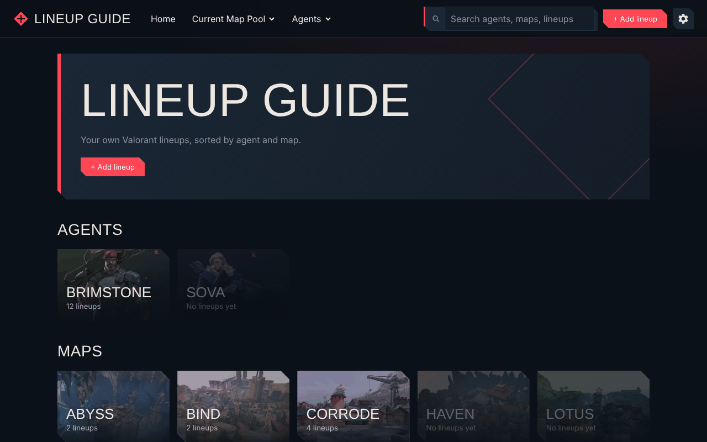
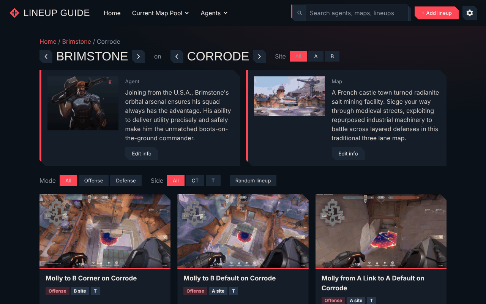

# Lineup Guide

A fast, good-looking site for keeping **your own Valorant lineups** in one place, organised by agent and map. Every lineup is a short set of steps with screenshots, so you can look one up in seconds and learn it properly.

No build step, no server, no account: it's one HTML file and one settings file.

<p align="center">
  
</p>
<p align="center">
  
</p>

## Features

- **Browse your way:** header menus for agents and the current map pool, plus arrows to step to the next or previous agent or map.
- **Filters:** mode (Offense/Defense), site (A/B/C) and side (CT/T).
- **Lineup steps:** *Go to this area*, *Aim here* and *To get this*, each with text and an image. Click any image to zoom.
- **Descriptions and pictures** for every agent and map, built in and editable.
- **Search** across agents, maps and lineup titles, including ones you have hidden.
- **Study tools:** favourites, a Random lineup button, Previous/Next (arrow keys work too), notes on each lineup and an image annotator.
- **Install it as an app** in Chrome or Edge (and on your phone) once it's hosted. It opens in its own window and works offline.
- **Bulk actions:** select several lineups to favourite, retag, delete or share them in one go.
- **Starter pack:** publish your lineups with the site so visitors see them straight away.
- **Switch agents and maps on or off** without touching code, so the site only shows what you play right now.
- **Share lineups** with friends as a single file, and import theirs.
- **Backup, restore and auto-save** to a file on your computer.
- Works on phones.

## Quick start (on your computer)

1. Download or clone this repo.
2. Keep `index.html` and `config.js` **in the same folder**.
3. Open `index.html` in Edge or Chrome.

> If you downloaded a zip, extract it first. Opening the page from inside the zip leaves `config.js` behind.

## Host it on GitHub Pages

1. Create a new repository and upload everything in this folder (`index.html`, `config.js`, `lineups.js`, `manifest.webmanifest`, `sw.js`, the two icons and the `docs` folder).
2. Go to **Settings → Pages**.
3. Under **Build and deployment**, choose **Deploy from a branch**, pick `main` and `/ (root)`, then save.
4. After a minute your site is live at `https://YOUR-USERNAME.github.io/YOUR-REPO/`.

Visitors get the built-in descriptions and images plus the starter lineups from `lineups.js` (see [Publish your lineups](#publish-your-lineups-with-the-site)). Anything they add themselves is stored in their own browser (see [Where your data lives](#where-your-data-lives)).

## Choosing agents and maps

There are two ways, and both do the same thing:

| Where | How |
| --- | --- |
| **`config.js`** | Set a name to `true` (shown) or `false` (hidden), save, refresh. This is the starting point. |
| **Settings (gear icon)** | Tick or untick agents and maps and press **Save settings**. These choices are remembered in your browser and win over `config.js`. **Reset to config.js** goes back to the file. |

Hidden agents and maps keep their lineups. Turn them back on and everything returns. Search still finds hidden ones.

## Adding lineups

1. Press **+ Add lineup**.
2. Pick the agent, map, mode, site and side, then give it a title.
3. Fill in the three steps. For each image, click the box to choose a file, drag one in, or paste a screenshot with Ctrl+V.
4. Save.

Images are saved as WebP at up to 1600 px wide, which keeps small details sharp when you zoom in to check where to aim. **Settings → Optimize images** re-saves older images the same way, usually about 20% smaller and visually identical.

**Editing descriptions and pictures:** open an agent or map page and press **Edit info**. **Settings → Reset descriptions** restores the built-in ones.

## Sharing lineups

**Pick them on the page (easiest):** on any agent and map page, press **Select to share**. Click lineups to tick them (a check shows in the corner), then press **Share selected**. You can add your name as credit and include the agent and map descriptions. Press **Done**, or Esc, to leave selection mode.

While lineups are ticked you can also use the bar to **favourite** them, **edit tags** (agent, map, mode, site, side or ability, changed on all of them at once) or **delete** them. Make a backup before deleting.

**Or use Settings → Share lineups:**

- **Export:** choose an agent and map (or *All*), optionally add your name as credit, and press **Export lineups**. You get one small file to send to a friend. Your favourites are not included. Tick the box to include agent and map descriptions too.
- **Single lineup:** open it and press **Share**.
- **Import:** press **Import lineups** and pick a file. You're told how many are new, duplicates are skipped, and if the lineups belong to a hidden agent or map you're offered to turn it on.

## Backups and auto-save

In **Settings**:

- **Backup** downloads everything (lineups, descriptions, images) as one file. **Restore** adds it back and skips duplicates.
- **Auto-save to a file** keeps a file on your computer up to date as you work. Choose or create the file once, and putting it in a OneDrive or Dropbox folder gives you a free offsite copy. It needs desktop Edge or Chrome, and after reopening the browser it asks you to reconnect with one click.

## Publish your lineups with the site

By default a visitor to your hosted site starts with no lineups. To give them yours:

1. Open **Settings → Publish to your website** and press **Create lineups.js**.
2. Upload that file to your repository next to `index.html`, replacing the old one.

First-time visitors get those lineups added automatically, and anyone who already visited gets the new ones the next time you publish. Lineups a visitor deleted can come back when you publish again. Descriptions you edited are included too. The file contains your screenshots, so it grows with every lineup (about 5 MB for a dozen); it only downloads once per visitor and is then cached.

## Install it as an app

Once the site is hosted on GitHub Pages (or any https address):

- **Chrome or Edge on a computer:** click the install icon in the address bar, or open **Settings → Use as an app** in the page and press **Install app**.
- **Android:** open the site in Chrome, then menu → **Install app**.
- **iPhone:** open it in Safari, then Share → **Add to Home Screen**.

The installed app opens in its own window and keeps working without a connection. It always checks for a newer version first when you're online, so updates show up without reinstalling. Installing also stops iPhone Safari from clearing your saved lineups after a week away.

## Where your data lives

Lineups are saved **in your browser** (IndexedDB), not in the HTML file and not on GitHub. That means:

- Each browser and each device has its own copy, and a hosted site opens empty the first time.
- Clearing site data wipes it, so keep a backup or turn on auto-save.
- Move lineups between devices with **Export lineups** and **Import lineups**, or **Backup** and **Restore**.

## Using it on your phone

Open the GitHub Pages link in your phone browser. Things to know:

- Auto-save to a file isn't available on phones, and paste and drag-and-drop don't exist on touch (picking from your gallery works).
- iPhone Safari may erase a website's saved data after about a week without visits unless it's added to your Home Screen. Add it to the Home Screen and keep a backup.
- Lineups you add on your phone don't sync to other devices. Use the share or backup files.

## Project files

```
index.html             the whole site (code, styles, built-in descriptions and images)
config.js              which agents and maps are switched on
lineups.js             the starter lineups visitors get (make a new one in Settings)
manifest.webmanifest   lets Chrome and Edge install the site as an app
sw.js                  makes the app work offline
icon-192.png           app icons
icon-512.png
docs/                  screenshots used in this README
```

## Disclaimer

Lineup Guide was created under Riot Games' "Legal Jibber Jabber" policy using assets owned by Riot Games. Riot Games does not endorse or sponsor this project. VALORANT and all related names, agent and map artwork and descriptions are the property of Riot Games.
